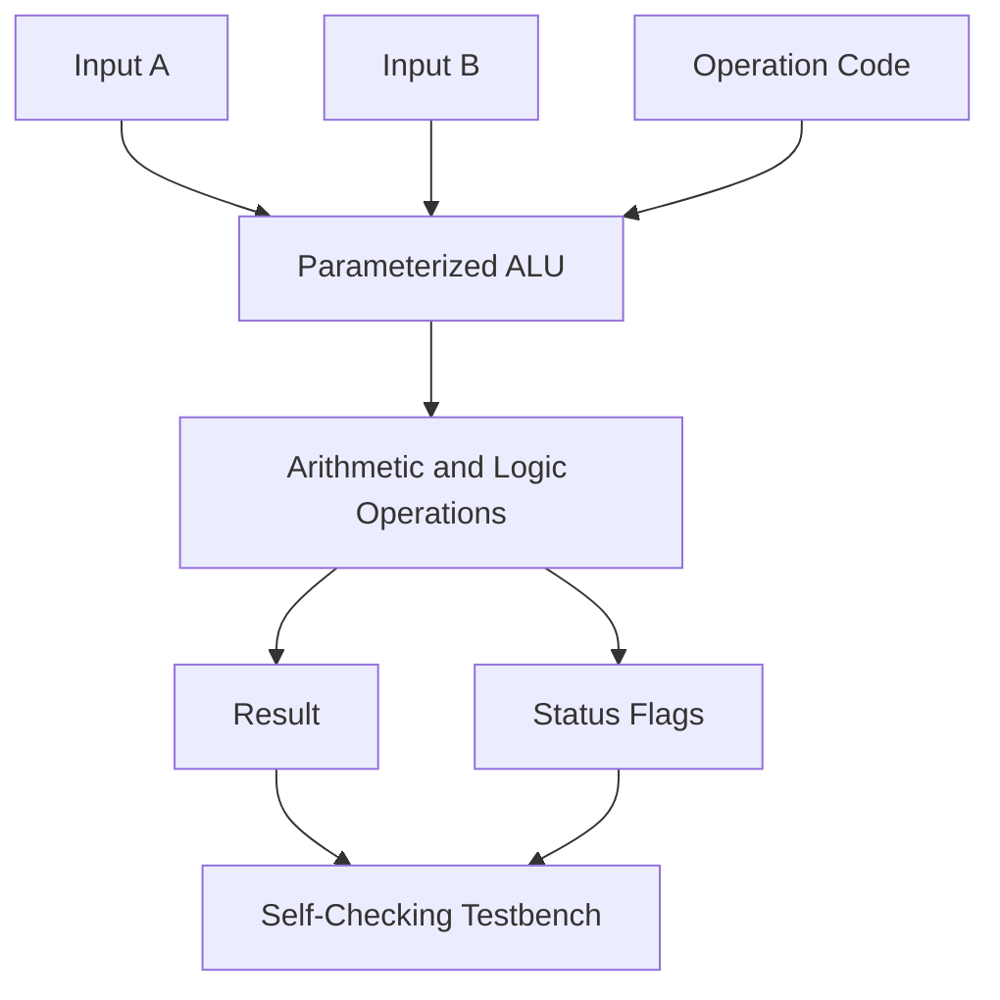
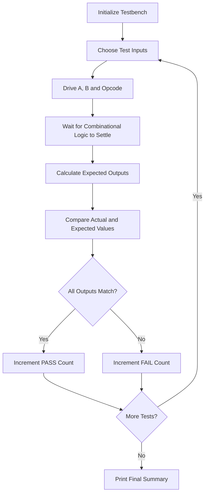

# ⚡ Parameterized ALU Design & Verification in Verilog

> **RTL Odyssey · Project 01**  
> Designing, simulating, and verifying a combinational Arithmetic Logic Unit using Verilog HDL and QuestaSim.

## 🎯 What I Learned From This Project

This project helped me practise the fundamentals of RTL design and functional verification by building and testing a parameterized ALU.

- 🧩 **Combinational RTL Design** — Implemented arithmetic, logical, shift, and comparison operations using Verilog.
- ⚙️ **Parameterized Design** — Used a `WIDTH` parameter to make the ALU configurable.
- 🚩 **Status Flags** — Worked with zero, negative, carry/borrow, and signed overflow flags.
- 🧪 **Self-Checking Testbench** — Created a reference model to calculate expected outputs and automatically compare them with the DUT.
- 🔍 **Directed & Random Testing** — Applied corner-case inputs and pseudo-random stimulus to exercise the design.
- 🐛 **Debugging with Waveforms** — Practised observing inputs, outputs, expected values, and status flags in QuestaSim.
- ✅ **Functional Verification** — Executed 2,400 test cases: 400 directed tests and 2,000 pseudo-random tests, with 0 failures in the initial simulation run.
- 🛠️ **RTL Debugging Practice** — Prepared to introduce a deliberate logic error and verify that the testbench detects it.

**Tools used:** Verilog HDL · QuestaSim 2024.1 · Git · GitHub

---

## 📌 1. Project Overview

An Arithmetic Logic Unit (ALU) is a fundamental digital circuit that performs arithmetic and logical operations on binary data. ALUs are commonly found inside processors, microcontrollers, and other digital systems.

In this project, I designed an 8-bit combinational ALU with 11 supported operations. I also developed a self-checking testbench to compare the design's actual outputs against independently calculated expected values.

The main goal was not only to write RTL, but also to understand how to verify its behaviour systematically.

### ✨ Key Features

- Configurable data width using a Verilog parameter
- 11 arithmetic, logical, shift, and comparison operations
- Zero, negative, carry/borrow, and signed overflow flags
- Combinational logic with default assignments to avoid unintended latches
- Automated expected-versus-actual output checking
- Directed corner-case tests and pseudo-random tests
- Simulation waveform inspection and failure reporting

## 🧠 2. ALU Operations

| Opcode | Operation | Description |
|:---:|---|---|
| `0000` | ADD | Adds two operands |
| `0001` | SUB | Subtracts operand B from operand A |
| `0010` | AND | Bitwise AND |
| `0011` | OR | Bitwise OR |
| `0100` | XOR | Bitwise exclusive OR |
| `0101` | NOT | Bitwise complement of A |
| `0110` | SLL | Logical shift left |
| `0111` | SRL | Logical shift right |
| `1000` | SRA | Arithmetic shift right |
| `1001` | SLT | Signed less-than comparison |
| `1010` | SLTU | Unsigned less-than comparison |

### 🚩 Status Flags

| Flag | Purpose |
|---|---|
| `zero` | Asserted when the result is zero |
| `negative` | Reflects the most significant bit of the result |
| `carry` | Indicates unsigned addition carry-out; for subtraction, this design uses `1` to indicate a borrow |
| `overflow` | Indicates signed arithmetic overflow |

**Important distinction:** Carry and signed overflow are different conditions. For an 8-bit signed ALU, `127 + 1` produces the bit pattern `10000000`, with `overflow = 1` and `carry = 0`.

## 🏗️ 3. Design Architecture

The design consists of two main parts: the ALU RTL and its verification environment.



### Design approach

1. Receive operands `a` and `b`, along with the operation code `op`.
2. Decode the opcode using a `case` statement.
3. Perform the selected combinational operation.
4. Generate the result and status flags.
5. Allow the testbench to compare the outputs against its reference model.

The ALU has no clock input because it is a combinational design.

## 🧪 4. Verification Architecture

A self-checking testbench automatically determines whether the DUT's outputs match the expected results.



### What the testbench checks

- Result correctness for each supported operation
- Correct behaviour for unsupported opcodes
- Zero and negative flag generation
- Carry and borrow behaviour
- Signed overflow conditions
- Differences between signed and unsigned comparisons

The testbench uses a reference model based on integer arithmetic to calculate expected results, rather than simply copying the DUT's internal logic.

## 📊 5. Verification Results

The initial QuestaSim run completed all 2,400 test cases.

| Test category | Number of tests |
|---|---:|
| Directed corner-case tests | 400 |
| Pseudo-random tests | 2,000 |
| **Total** | **2,400** |
| **Passed** | **2,400** |
| **Failed** | **0** |

### Initial simulation summary

```text
WIDTH=8  PASS=2400  FAIL=0
RESULT: ALL TESTS PASSED
```

These results confirm that the DUT matched the reference model for the test cases executed in this run. They do not, by themselves, prove that every possible input combination is correct.

### Waveform inspection

The simulation waveform allows the inputs, actual outputs, expected outputs, and status flags to be examined over time.

**Suggested screenshot:** Add your QuestaSim waveform screenshot here after saving it in the repository.

```markdown

```

Create the `docs/images/` folder and place your screenshot there using the filename `alu-waveform.png`. The image will display once the file is committed and pushed to GitHub.

## 🛠️ 6. Tools & Technologies

| Tool / Technology | Purpose |
|---|---|
| Verilog HDL | RTL design and testbench implementation |
| QuestaSim 2024.1 | Compilation, simulation, and waveform debugging |
| Git | Version control |
| GitHub | Source-code hosting and project documentation |

**Note:** Vivado synthesis and FPGA implementation are not part of the initial verification results documented above.

## 📂 7. Project Structure

```text
RTL-Odyssey/
└── Project-01-Parameterized-ALU/
    ├── alu.v
    ├── tb_alu.v
    ├── README.md
    └── docs/
        └── images/
            └── alu-waveform.png
```

- `alu.v` — Parameterized combinational ALU.
- `tb_alu.v` — Self-checking testbench and reference model.
- `README.md` — Project overview, architecture, and results.
- `docs/images/` — Simulation screenshots and supporting visuals.

Adjust the filenames or folder names if your actual repository structure differs.

## ▶️ 8. How to Run the Simulation

Open QuestaSim and use the Transcript window.

### Step 1: Compile the RTL

```tcl
vlog alu.v
```

### Step 2: Compile the testbench

```tcl
vlog tb_alu.v
```

### Step 3: Load the simulation

```tcl
vsim work.tb_alu
```

### Step 4: Add waveform signals

```tcl
add wave -r sim:/tb_alu/*
```

### Step 5: Run all tests

```tcl
run -all
```

Check the Transcript window for the final PASS/FAIL summary.

If you modify the RTL, recompile it and reload the simulation to ensure that the updated design is used.

## 🐛 9. Debugging & Verification Lessons

This project reinforced several important lessons:

- A successful compilation does not guarantee correct functionality.
- A waveform helps explain what the circuit did, while a self-checking testbench helps determine whether it did the right thing.
- Signed overflow and unsigned carry must be evaluated separately.
- Corner cases are essential for testing arithmetic boundaries.
- A reference model can also contain bugs, so independent known-answer tests are valuable.
- Introducing a deliberate fault is a useful way to assess whether a testbench can detect incorrect behaviour.

### Planned fault-injection experiment

A planned experiment is to change the XOR implementation temporarily so that it performs AND instead. The testbench should detect mismatches for affected input combinations.

The experiment will be recorded as completed only after the modified design produces the expected verification failures.

## 🚀 10. Future Improvements

- [ ] Complete and document the deliberate fault-injection experiment.
- [ ] Debug a failing test by tracing its inputs and outputs in the waveform.
- [ ] Improve shift-operation reference-model coverage.
- [ ] Add reproducible random seeds and more targeted boundary tests.
- [ ] Test additional parameter widths, such as 4-bit and 16-bit configurations.
- [ ] Run synthesis in Vivado if targeting a supported Xilinx FPGA.
- [ ] Record synthesis results and resource utilization where applicable.

## 📚 11. Key Concepts Practised

`RTL Design` · `Combinational Logic` · `Verilog Parameters` · `ALU Architecture` · `Self-Checking Testbench` · `Reference Model` · `Directed Testing` · `Random Testing` · `Waveform Debugging` · `Functional Verification`

## 👨‍💻 About This Project

**RTL Odyssey** is my hands-on journey into RTL design, FPGA development, and digital verification. I am building projects incrementally to strengthen my understanding of hardware design, simulation, debugging, and verification methodology.

This ALU is the first project in that journey, with an emphasis on understanding the design and learning how to test it—not just making the code compile.

---

⭐ *One project at a time. One concept at a time. Building stronger RTL fundamentals through hands-on practice.*
